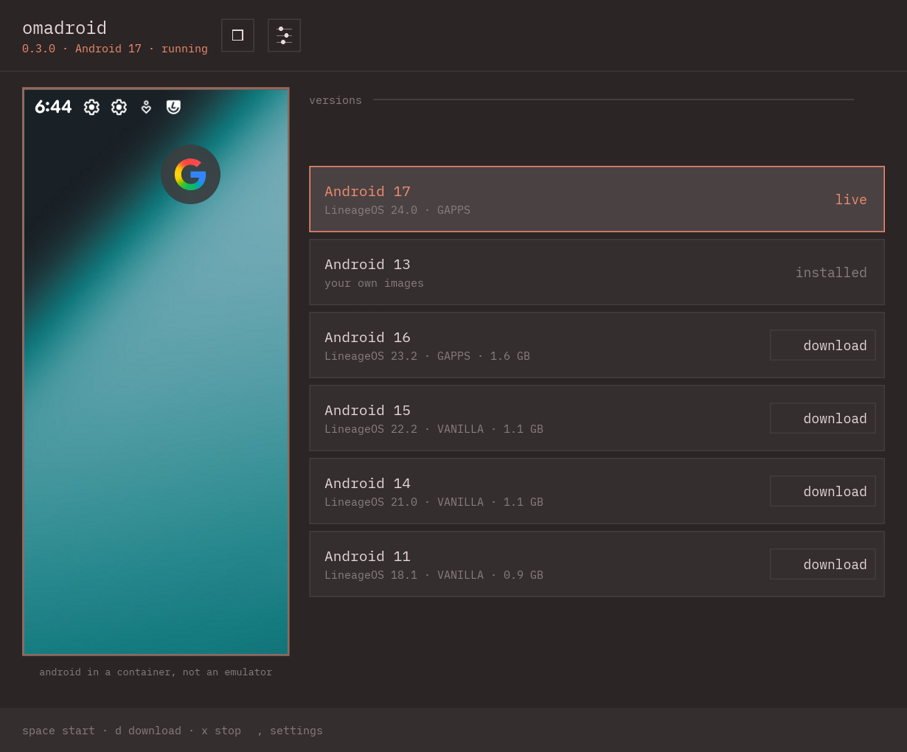

<p align="center">
  <!-- omadroid - App Icon -->
  <a href="https://github.com/abraham-ukachi/omadroid" target="_blank">
    
  </a>
</p>


<p align="center" style="width:512px; margin:0 auto;">
  <b>omadroid</b> is a dead-simple Android phone on your <b>Omarchy</b> desktop, written in <b>Rust</b> 🦀 and <b>Slint</b>, with Omarchy's look &amp; feel. Every Android version is one key away.
</p>


# `omadroid`


> IMPORTANT: This is a work in progress and subject to major changes until version 1.0.


## What is omadroid? 📱

You want to try your app on Android 13, then Android 17, without a phone farm, a two-minute emulator boot or a terminal full of `waydroid init`. **omadroid** is one small window: a list of Android versions, a phone silhouette that tells you what is live, and a bar that fills while an image downloads.

It is not an emulator, and that is the point. Android runs in a **container** on the kernel you already have, through [Waydroid](https://waydroid.org). No CPU emulation, no video encoding, no fake GPU: apps run at native speed, and the phone's window composites on Hyprland like any other window.

What omadroid adds is everything Waydroid leaves to the terminal:

- **One Android version per directory**, each with its own `/data`, so your Android 13 apps and your Android 17 apps never meet.
- **A four-second switch**: Waydroid's `images_path` is rewritten, the data symlink follows, the container restarts. Nothing is copied.
- **A live catalog** built from the community builds (`WayDroid-ATV/waydroid-builds`): Android 11 through 17, x86_64, downloaded and unpacked for you.
- **Waydroid installed for you** on first launch, if the machine has none: one button, Arch's `extra` package, then the images Waydroid fetches itself.
- **Android inside the phone panel**: the phone window is pinned onto the panel and follows omadroid when it moves or resizes, so the phone is the phone.
- **Fullscreen phone**: the button beside settings (or `f`) gives the phone the whole monitor, `esc` gives it back.
- **Out of the way when you leave**: when another window takes the keyboard the phone parks itself on `special:omadroid` and is placed again when omadroid has it back.
- **Settings in the window**: versions, keys, about — and `download` is a button, not a word.
- **Omarchy's clothes**: the accent is read live from `colors.toml`, corners follow Hyprland's `decoration:rounding`, every key is a shortcut.

> MOTTO: The phone is real. The emulator is not.


## How a switch works ⚡

| No. | Step | What it costs |
|:----|:-----|:--------------|
| 1 | `waydroid session stop` and wait for the container | ~2 s |
| 2 | Point `~/.local/share/waydroid/data` at `versions/<version>/data` | a symlink |
| 3 | Clear the system/vendor overlay of the previous version | a rename |
| 4 | Write `images_path` into `/var/lib/waydroid/waydroid.cfg` | one line, `sudo` |
| 5 | `waydroid session start` + `show-full-ui` | ~4 s to the home screen |

There is no image copy and no reboot, which is why it beats every emulator at the one thing you actually do all day: change version.


## The phone panel 📲

The phone is the left half of the window: bezel, screen, the whole shape, sized from the window and capped at the height of a real phone. When Android runs, **the Android window sits exactly there** — you type into the phone, it stays above the app while you click the list, and it is dragged along when the omadroid window moves.

How that is done, stated plainly: a Wayland application cannot take another application's surface and paint it as a widget. Slint has no way to host the Waydroid window, and no amount of Rust changes that. So omadroid asks Hyprland instead: the Waydroid window is made floating and pinned, and moved and resized onto the exact rectangle the panel occupies, two pixels inside its accent border. It looks embedded, it behaves embedded, and on a compositor without `hyprctl` it degrades to a normal window (`O` brings it back).
Android draws at the resolution its own display reports — 1920x1080 here — and the compositor scales that buffer to the window. That is what makes the phone look zoomed and cut off at panel size, and it is measured, not guessed: `waydroid shell wm size 720x1536` (or 357x765, or 238x510) does move Android's display, but Waydroid's window then paints pure black until the override is reset. A phone the right shape and black is worse than one the wrong shape and visible, so omadroid leaves the display alone until Waydroid can be restarted at the new size, which is a bigger piece of work than a window resize.

The phone also leaves when you do: it is pinned above the tiling layout, so when another window takes the keyboard it is parked on `special:omadroid`, and comes back — placed again, because the compositor does not keep its rectangle — the moment omadroid has the keyboard. One caveat, measured: Waydroid's own window asks for focus by itself, pinned or not, so on a machine where it keeps doing that the park never triggers and the phone stays where it is.

> MOTTO: A panel you can type into, not a screenshot.


## Installation 📦

Requires an Arch system with `pacman`, a Wayland session, `curl` and `unzip`. If Waydroid is not on the machine, the first window offers one button: it installs `waydroid` from Arch's `extra`, enables the container, and runs `waydroid init -f -s GAPPS` — the images (about 1.6 GB) are what Waydroid downloads itself. That needs root, so `sudo -n` is tried first and `pkexec` after it; if neither will take it, the window says which command to run.

```bash
cd ~/Work/omadroid
bin/install          # builds the package with makepkg -fsi
```

Or build and run it from the tree:

```bash
bin/build
./build/omadroid
```

The app appears in the Omarchy launcher (`Super + Space`) as **omadroid**.


## Keyboard shortcuts ⌨️

| Key | Action |
|:----|:-------|
| `j` / `k` | Next / previous version |
| `Space` or `S` | Start the selected version |
| `D` | Download it (the word `download` in a row does the same) |
| `X` | Stop Android |
| `O` | Bring the phone window back |
| `R` | Remove an installed version |
| `Shift+R` | Refresh the catalog |
| `,` or `?` | Settings: versions, keys, about |
| `Esc` | Close the settings |
| `Q` | Quit |


## Where things live 🗂️

| No. | Path | What |
|:----|:-----|:-----|
| 1 | `~/.config/omadroid/omadroid.json` | Which images the machine had before omadroid |
| 2 | `~/.local/share/omadroid/versions/<id>/` | `system.img`, `vendor.img`, `data/`, `meta.json` |
| 3 | `~/.local/share/waydroid/data` | A symlink to the live version's `data/` |
| 4 | `/var/lib/waydroid/waydroid.cfg` | `images_path`, rewritten on every switch |

An installed version is about 3.2 GB of images plus its data. Removing one deletes its directory; the images Waydroid had before omadroid are never touched.


## Versions 🧬

| Android | LineageOS | Source | Status |
|:--------|:----------|:-------|:-------|
| 17 | 24.0 | `WayDroid-ATV/waydroid-builds` | ✅ catalog |
| 16 | 23.2 | `WayDroid-ATV/waydroid-builds` | ✅ catalog |
| 15 | 22.2 | `WayDroid-ATV/waydroid-builds` | ✅ catalog |
| 14 | 21.0 | `WayDroid-ATV/waydroid-builds` | ✅ catalog |
| 13 | 20.0 | official OTA, or the builds above | ✅ catalog |
| 11 | 18.1 | `WayDroid-ATV/waydroid-builds` | ✅ catalog |

The list is read from GitHub at run time, so a new release shows up without a rebuild. GAPPS builds win over VANILLA when a release ships both: that is the phone people expect.


## Tech stack & versions 🧰

| Tool | Version | Notes |
|:-----|:--------|:------|
| [Rust](https://www.rust-lang.org) | **stable** (1.99) | Edition 2021. Release profile: `opt-level = "s"`, LTO, stripped. |
| [Slint](https://slint.dev) | **1.18** | The window (`app/ui/*.slint`), iA Writer Mono, two colors and their mixes. |
| [Waydroid](https://waydroid.org) | **1.6.3** | The container that runs Android. |
| `curl` + `unzip` | system | Resumable downloads, image extraction. No TLS stack to compile. |


## Limits, honestly 🚧

- **One Android version live at a time.** Waydroid has a single container; omadroid makes switching instant, not simultaneous.
- **The panel scales Android rather than matching it.** `wm size` sets the display, but Waydroid renders the window black afterwards; matching the two needs Waydroid restarted at the panel's size.
- **The phone can keep the keyboard.** Waydroid's window asks for focus itself, so clicking another window does not always take it — and the park-on-blur relies on exactly that.
- **The phone panel is Hyprland placement, not embedding.** Wayland gives no application the right to host another's surface. The Android window is pinned and moved onto the panel, so it is genuinely interactive — but on a compositor that is not Hyprland it stays a separate window.
- **The first-run install is `pacman` plus `waydroid init`.** It is not a vendored runtime; it needs Arch, a network, root, and a kernel with binder (Omarchy has one).
- **Community images are unofficial.** Android 14, 15, 16 and 17 come from `WayDroid-ATV/waydroid-builds`; a broken release is possible and the window says so instead of hiding it.
- **Play Store needs GAPPS, and certification still refuses some apps.** No container fixes SafetyNet; banking apps may refuse to run.
- **No translations yet.** Strings are inline in `ui/app.slint`; the Translator from the Omarchy app guide is the next step.


## Development 🛠️

```bash
bin/test     # core tests + clippy, -D warnings
bin/build    # release binary in build/omadroid
bin/install  # Arch package via makepkg -fsi
```

See [AGENTS.md](./AGENTS.md) for the map of the repo and [CONTRIBUTING.md](./CONTRIBUTING.md) for the commit style.


## License

MIT License — see [LICENSE](LICENSE).
